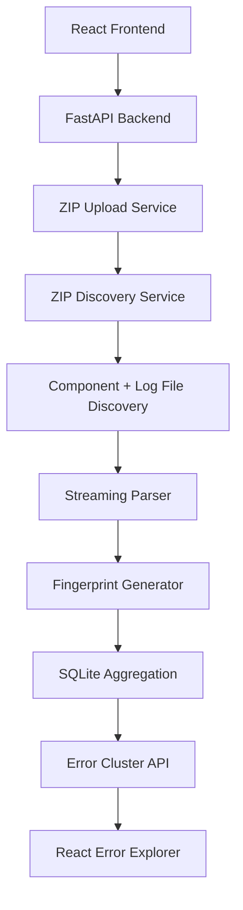

# Architecture

## Current implementation

### Frontend
- React + Vite application in frontend/
- Upload and job-status flow are exercised through the FastAPI API

### Backend
- FastAPI app entry point in Backend/app/main.py
- Upload route in Backend/app/routes/uploads.py
- Discovery logic in Backend/app/services/zip_discovery.py
- Parsing logic in Backend/parse_logs.py
- Fingerprinting and aggregation in Backend/fingerprint.py
- Job lifecycle and SQLite synchronization in Backend/app/services/job_manager.py

### Data flow
1. ZIP files are uploaded via the upload endpoint.
2. The archive is validated and stored under Backend/storage/uploads.
3. Archive entries are inspected without extracting the full archive.
4. Supported component and log files are discovered; excluded component paths are not passed to the normal parser pipeline.
5. Each supported file is parsed incrementally.
6. ERROR records are normalized and fingerprinted.
7. Matching fingerprints are stored in SQLite and grouped globally.
8. API clients request job status, cluster summaries, and occurrence pages.

## Verified modules
- ZIP upload
- ZIP validation
- ZIP metadata discovery
- DWrapper/DServer parser compatibility
- Exact ERROR filtering and malformed-line tracking
- Disk-backed clustering with SQLite
- Job status polling and cluster pagination

## Explicitly out of scope for this phase
- Nested ZIP extraction or recursive archive expansion
- CONXApp parsing
- ServerAPIConnector parsing
- Neptune integration
- Vendor report generation
