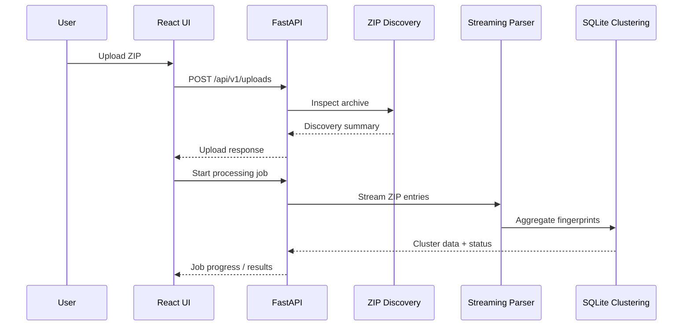

# Pipeline Flow

## Stage 1: ZIP upload
- Input: uploaded archive file
- Processing: file is streamed to disk in 1 MB chunks
- Output: stored ZIP under Backend/storage/uploads
- Responsible module: Backend/app/routes/uploads.py
- API: POST /api/v1/uploads
- Error handling: rejects invalid extension, non-ZIP files, oversized uploads
- Status: Implemented

## Stage 2: ZIP discovery
- Input: stored ZIP path
- Processing: enumerate ZIP entries, detect supported components, and classify files without extracting nested archives
- Output: file inventory and component mapping
- Responsible module: Backend/app/services/zip_discovery.py
- API: upload response contains discovery metadata
- Error handling: invalid archive raises a BadZipFile error
- Status: Implemented for supported archive metadata discovery; nested ZIP extraction remains out of scope

## Stage 3: Log processing
- Input: discovered supported ZIP log entries
- Processing: open archive members incrementally, parse line by line, maintain malformed line counters, and emit ERROR records
- Output: per-file parse status and error stream
- Responsible modules: Backend/parse_logs.py and backend processing services
- API: processing job endpoints
- Error handling: malformed lines are counted; excluded component files are skipped before parser execution
- Status: Implemented and verified for DWrapper/DServer inputs

## Stage 4: Fingerprint aggregation
- Input: parsed ERROR records from supported components
- Processing: normalize message values, create SHA-256 fingerprint keys, aggregate by qualified function and normalized message, and preserve per-occurrence provenance
- Output: global cluster records in SQLite
- Responsible modules: Backend/fingerprint.py
- API: job cluster endpoints
- Error handling: invalid records are rejected and logged as processing errors
- Status: Implemented and verified

## Stage 5: React display
- Input: cluster summaries and paginated occurrences
- Processing: display cluster summaries and job status through the frontend flow
- Output: user-visible upload and processing status experience
- Responsible modules: frontend/src/App.jsx and related components
- API: upload, job status, cluster, and occurrence endpoints
- Error handling: display server errors and empty states
- Status: UI flow is present and the frontend production build passes; detailed cluster explorer remains a follow-on enhancement

